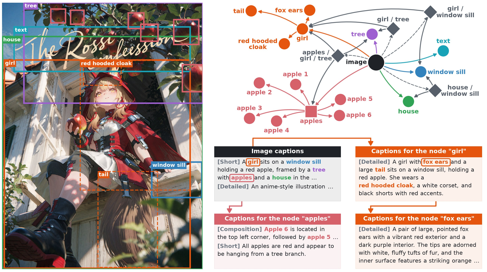
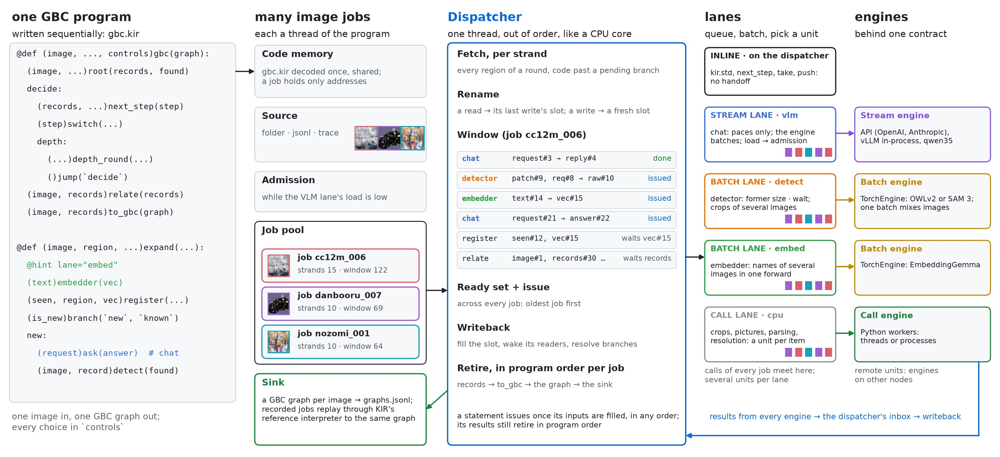
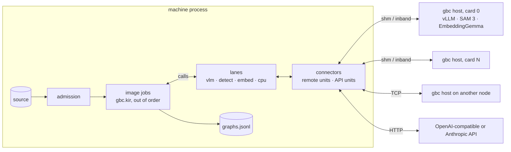
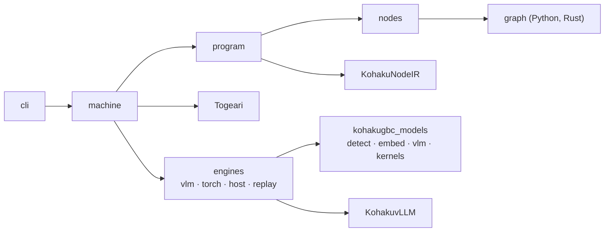

# KohakuGBC

[](https://arxiv.org/abs/2407.06723)
[](https://github.com/apple/ml-gbc)



Graph-Based Captioning ([GBC](https://arxiv.org/abs/2407.06723)) as one
[KIR](https://github.com/KohakuBlueleaf/KohakuNodeIR) program on the
[Togeari](https://github.com/KohakuBlueleaf/Togeari) dataflow machine, with the engines that run
it: a VLM over any OpenAI-compatible or Anthropic API, vLLM in-process or a specialised Qwen3.5
engine; OWLv2 or SAM 3 for detection; EmbeddingGemma for names; on one GPU, many GPUs or other
nodes.

Producing one GBC graph is a branching process: ask the VLM, detect what it named, describe each
region, detect its parts, merge regions that are the same object, ask relational questions. Its
control flow differs per image and cannot be batched across images by hand. KohakuGBC writes
that process once, as a sequential KIR program; Togeari runs many images at once, overlaps every
call the sequential run cannot tell apart, and turns their model calls into batched engine calls.



**Contents:** [Highlights](#highlights) · [Install](#install) · [Quick start](#quick-start) ·
[How it works](#how-it-works) · [Configuration](#configuration) · [Output](#output) ·
[Faithful to GBC](#faithful-to-gbc) · [Measured](#measured) ·
[Repository layout](#repository-layout) · [Documentation](#documentation) · [Checks](#checks)

## Highlights

- **2.06 images/s on one RTX 5090, 8.17 on four.** Qwen3.5-4B, SAM 3 and EmbeddingGemma on each
  card, about 15 vertices and 27 captions per graph; each image is 41 s in the machine at the
  median, however long the source runs. Four cards give 3.96x one card
  ([measured](#measured)).
- **Engines in their own processes.** Every card's engines run in an engine host process; the
  machine's process holds connectors and the dispatcher only, over shared memory. That is +9%
  over the same engines in the machine's process, and the same connector reaches engines on
  other nodes.
- **vLLM 3.1x faster on this workload.** [KohakuvLLM](https://github.com/KohakuBlueleaf/KohakuvLLM)
  (a drop-in vLLM plugin) takes `vllm serve` from 11.4 to 35.0 requests/s on one RTX 5090: FP8
  GDN projections, a bf16 or INT8 GDN state, a Rust JSON grammar, and a phased scheduler. Every
  reply is schema-valid.
- **GBC at scale, with the models you choose.** Thousands to millions of images through a hosted
  API, your own vLLM or SGLang servers, or engines on your GPUs; engines on other nodes join the
  same lanes.
- **Exactly the sequential procedure.** Every job can be recorded and replayed through KIR's
  reference interpreter. On recorded runs of GBC's proof of concept, every graph equals the
  PoC's to the digest.
- **The procedure as data.** The root (an image query, existing captions, tags), the node budget,
  the fan-out and the relational questions are per-image `controls`; the detector is one setting.
- **One engine contract.** Every engine, from an HTTP server to the qwen35 engine written for this
  workload, sits behind Togeari's contract and is checked against it.

## Install

```
pip install kohakugbc-data            # graphs and datasets only: no machine, no GPU stack
pip install kohakugbc                 # program, machine, API and replay engines
pip install "kohakugbc[torch]"        # detector (OWLv2, SAM 3) and embedder on torch
pip install "kohakugbc[vllm]"         # the VLM in-process through vLLM (Linux)
pip install "kohakuvllm @ git+https://github.com/KohakuBlueleaf/KohakuvLLM"   # our vLLM parts
pip install "kohakugbc[qwen35]"       # the qwen35 VLM engine (Windows and Linux)
```

Two packages from this repo:

- `kohakugbc-data` (`packages/kohakugbc-data`, on PyPI): the GBC graph (store, resolution,
  prompt rendering) and the GBC dataset format, with its Rust extension; depends on numpy,
  pillow, pyarrow and kohakuvault only. Training code and dataset tools use this alone.
- `kohakugbc` (pure Python): the program, machine and engines, on top of `kohakugbc-data`.

From a clone, with a Rust toolchain:

```
git clone https://github.com/KohakuBlueleaf/KohakuGBC && cd KohakuGBC
uv venv -p 3.13
uv pip install -e packages/kohakugbc-data -e ".[torch,qwen35,dev]"   # torch: the index matching your driver
gbc doctor
```

`gbc doctor` prints versions, devices with their free memory, every entry per slot and, given
configuration layers, their placement plan and whether it fits.

## Quick start

**On one GPU**, the VLM, the detector and the embedder in this process (`configs/machine/
qwen35_local.py`: Qwen3.5-4B on the qwen35 engine, OWLv2, EmbeddingGemma on the CPU; 24 GiB):

```
GBC_IMAGES=path/to/images gbc run configs/machine/qwen35_local.py
# SAM 3 as the detector (illustrations):
GBC_IMAGES=path/to/images gbc run configs/machine/qwen35_local.py configs/machine/qwen35_sam3_local.py
```

One graph per image lands in `runs/machine/qwen35_local/graphs.jsonl`; the teaser above is the
graph of its image (29 vertices, the figure shows 20; 51 edges, 48 captions), drawn by
`scripts/docs/teaser.py`:

```
{"vertices":[{"vertex_id":"","bbox":{"left":0.0,"top":0.0,"right":1.0,"bottom":1.0,"confidence"
:null},"label":"image","descs":[{"text":"An anime-style illustration depicts a young girl with
blonde hair and fox-like ears sitting on a weathered wooden window sil ...
```

**Over an API**, the VLM on a server (vLLM, SGLang, llama.cpp, OpenAI, OpenRouter, Anthropic),
the vision models here:

```python
# my_run.py
engines = {
    "vlm": {
        "entry": "api",
        "protocol": "openai",
        "flavour": "vllm",
        "model": "Qwen/Qwen3.5-4B",
        "endpoints": [{"base_url": "http://10.0.0.5:8000/v1", "max_inflight": 64}],
        "metrics": "vllm",
    },
    "detect": {"entry": "torch", "model": "facebook/sam3", "dtype": "bfloat16"},
    "embed": {"entry": "torch", "devices": ["cpu"]},
}
source = {"kind": "folder", "path": "images"}
sink = {"kind": "graphs", "path": "runs/my_run/graphs.jsonl"}
machine = {"report": "runs/my_run/report"}
```

```
gbc check my_run.py      # build the machine without starting a unit; every problem at once
gbc run my_run.py
```

**Without models**, the recorded PoC runs replayed: the program and the machine on pseudo
engines, every graph equal to the PoC's.

```
gbc run configs/machine/replay_text.py
```

**From Python**:

```python
from kohakugbc.machine import build

machine, source, sink = build(
    "configs/machine/qwen35_local.py", {"source": {"kind": "folder", "path": "images"}}
)
with machine:
    machine.run(source, sink)
```

| Command | Does |
|---|---|
| `gbc run CONFIG [CONFIG ...]` | builds the machine from configuration layers and runs its source into its sink |
| `gbc check CONFIG ...` | builds and checks the machine without starting any unit |
| `gbc host CONFIG ... --slot S --listen HOST:PORT` | serves slot S's units to machines on other nodes |
| `gbc doctor [CONFIG ...]` | versions, devices, entries; a configuration's placement plan |

## How it works

| Layer | Package | Holds |
|---|---|---|
| GBC program | `kohakugbc.program`, `kohakugbc.nodes`, `kohakugbc.graph` | `gbc.kir` (one image job), the node library `gbc`, controls, records and graph resolution (Python reference; Rust in `kohakugbc-data`, equal by digest) |
| GBC machine | `kohakugbc.machine`, `kohakugbc.io` | the program on Togeari: one lane per engine slot, bindings, admission, sources, sinks, configuration layers |
| GBC engines | `kohakugbc.engines`, `kohakugbc_models` | entries per slot, the placement plan, engines on other nodes, replay engines for runs without models |

### The GBC graph

A GBC graph describes one image as a DAG. The image vertex carries a short and a detailed
caption; the objects those captions name are entity vertices with their own captions and boxes;
their parts hang below them; composition vertices arrange several instances of one object;
relation vertices describe how objects relate. Every edge is grounded three ways: it is a graph
edge, its label is a phrase of the parent's caption, and the child's box lies inside the parent's.

### The program: one image job


The root describes the image and finds the objects it names; a round runs every waiting region
as its own job (seen before? describe it, find its parts), and the parts it finds wait for the
next round. A decision then runs another round one level deeper, asks the VLM what the image
still holds and adds those objects, or ends with the relation questions. Every step marked ×?
spawns as many jobs as its reply names, and the decision how many rounds run, so each image
grows its own workflow while it runs: from 3 VLM requests on one image to more than 30 on
another. That work cannot be batched stage by stage across images without waiting for the
slowest one; the machine instead runs every job as soon as its inputs exist and batches whatever
calls are ready, across images (`scripts/docs/workflow.py`).

`gbc.kir` is a plain sequential program; this is its top level:

```
@def (image, captions = None, tags = None, controls = None)gbc(graph, stats):
    (image, captions, tags, controls)root(records, found)      # the image vertex, what it names
    ...
    decide:
        (records, frontier, rounds, breadth, stop, controls)next_step(step)
        (step)switch("depth"=>`depth`, "breadth"=>`widen`, _=>`done`)
        widen:                                                 # one more root sentence
            (image, records, controls)coverage(records, found, grew)
        depth:                                                 # one round of regions
            (image, frontier, records, seen, controls)depth_round(frontier, records, seen)
        done:
    (image, records, controls)relate(records)                  # relations, compositions
    (image, records, controls)to_gbc(graph, stats)             # records to the GBC graph
```

| `@def` | Does |
|---|---|
| `root` | the image vertex: GBC's image query, or existing captions (text, image and text, tags) |
| `detect` | the regions detection finds for the named entities in a parent's box, one level down |
| `expand` | one region: it joins a vertex seen before (same object by name embedding and box overlap), or it is described and its parts detected |
| `wave`, `depth_round` | one round: the frontier as it was when the round began, in waves that take what the node budget still needs; a wave's regions run side by side |
| `coverage` | one more root sentence naming objects not covered yet |
| `relate` | relation and composition questions over the graph |
| `ask` | a VLM request; a failed one answers with an empty reply, as GBC reads one |

Model calls are transport-only nodes (`chat`, `detector`, `embedder`); requests are built and
replies parsed by plain nodes, so the same requests and parsing run on every engine.

### Controls

One job input holds every choice about what the graph contains; a configuration's `controls`
are the defaults under each job's own.

| Control | Default | |
|---|---|---|
| `root` | `query` | `query` (the VLM describes the image), `text` / `image_text` (from existing captions), `tags` (from tags) |
| `min_nodes`, `max_nodes`, `max_rounds` | 8, 20, 4 | node budget on image and entity vertices; rounds stop at the maximum, breadth rounds run below the minimum |
| `max_top_level`, `max_features_per_entity`, `max_instances_per_text`, `max_depth` | 6, 4, 6, 3 | fan-out caps and depth |
| `box_score`, `nms_iou`, `nms_iou_single`, `drop_containers` | 0.1, 0.2, 0.05, True | detection selection: score cut, NMS IoU (multiple / single objects), a box containing another dropped; the PoC's, tuned for OWLv2 |
| `round_size`, `priority`, `max_breadth_rounds`, `coverage_max_new` | None, `area_depth`, 1, 4 | regions per round and their order; coverage rounds |
| `entity_batch`, `leaf_caption` | 1, `query` | regions per VLM request; leaves captioned by their own request or by the parent's reply |
| `relational`, `relate` | `both`, `end` | which relational questions; asked once at the end or after every round |
| `max_side` | 1568 | pictures sent to the VLM: the longer side scaled down to this |
| `same_threshold`, `overlap_threshold` | 0.725, 0.85 | same-object check: name-embedding similarity and box overlap |
| `tag_threshold`, `tag_hint` | 0.35, False | tags as elements of a seeded root; tags in the element prompt |

Control presets are configuration layers in `configs/controls/`: `small`, `mid`, `large` (graph
size), and `sam3` (SAM 3's selection: `box_score` 0.3, `nms_iou` 0.7; the PoC's 0.2 removes
overlapping objects, two people embracing at IoU 0.5), stacked after a machine configuration
(`configs/machine/<m>.py configs/controls/mid.py configs/controls/sam3.py`). On the 30 PoC
images with SAM 3 (Qwen3.5-4B FP8 on vLLM, one RTX 4090, 64 VLM requests in flight):

| Preset | 30 images | Vertices | Entities | Captions |
|---|---|---|---|---|
| small + sam3 | 42.9 s | 10.7 | 6.2 | 18.2 |
| mid + sam3 | 62.0 s | 14.7 | 8.8 | 26.8 |
| large + sam3 | 92.8 s | 21.6 | 14.0 | 40.8 |
| the PoC's graphs (OWLv2) | | 15.2 | 9.4 | 26.3 |

### The machine



Togeari runs each image job like a thread on an out-of-order CPU core: statements issue as soon
as their inputs exist, a branch still being decided parks while the code after it runs ahead, a
`parallel` or `each` fans out, and a window retires everything in program order, so a job's
result is exactly the sequential run's. Across jobs, every model call of one kind joins one
lane: the detect lane batches crops from many images into one forward, the VLM lane keeps its
units' queues full.

Each lane's units are connectors. With `GBC_HOSTING=process` (the default of
`configs/machine/qwen35_card.py`), the machine starts one `gbc host` per card running that card's
engines, and the lane holds a remote unit for each. The dispatcher then has its process's GIL to
itself: it does not share it with vLLM's frontend or SAM 3's preparation. Images and tensors
travel in shared-memory blocks, everything else as small messages, and capacity and load are
reported back at least every 0.2 s
([engine hosts](docs/internals/engine-host.md)). The same engines in the machine's process
(`GBC_HOSTING=inprocess`) remain one setting away.


One run of the machine from its event log (`scripts/docs/machine_view.py`). It is 240 COCO
images on one RTX 5090 with the defaults of `configs/machine/qwen35_card.py` (engines in a host
process, 96 resident images), taking 126 s for 19,849 engine calls (1.91 img/s, loading
excluded). Left, each image is a row and each engine call a bar in its lane's colour. The first
96 images are admitted at once, and each later image enters as one finishes, so images overlap
on the shared engines. Right, the VLM lane fills to its 384 lanes as the first images fan out,
then holds 100–300 requests in flight as images come and go. A single image keeps up to 10 of
its own VLM requests in flight at once.

| Slot | Node | Lane | Entries |
|---|---|---|---|
| `vlm` | `chat` | stream units | `api`, `vllm`, `qwen35` (the `qwen35` extra), `replay`, `remote` |
| `detect` | `detector` | batch units | `torch` (OWLv2 or SAM 3), `replay`, `remote` |
| `embed` | `embedder` | batch units | `torch` (EmbeddingGemma), `replay`, `remote` |
| `cpu` | crops, pictures, parsing, resolution | worker pool | `python` (threads or processes), `remote` |

Admission keeps the VLM lane at its target load (`vlm_waiting`): an image is admitted while the
lane's queue and its units' waiting counts are below it, every other lane in `waiting` is below
its limit, and fewer than `max_jobs` images are resident. `max_jobs` bounds an image's time in the
machine (about `max_jobs` / throughput) however long the source runs. Each slot's entry is
selected once; the placement plan adds up what every engine holds on every device and refuses a
configuration that does not fit before any weight loads.

### Engines

| Entry | Slot | Runs | Notes |
|---|---|---|---|
| `api` | vlm | any OpenAI-compatible server or Anthropic's Messages API, one unit per endpoint | `flavour` places the JSON schema and turns Qwen3.5's thinking off per server kind; rate limits, health checks, `X-GBC-Request` digests |
| `vllm` | vlm | vLLM's `AsyncLLM` in this process, one unit per device group | tensor parallel over a unit's devices; its reservation in the placement plan |
| `qwen35` | vlm | a Qwen3.5 engine written for this workload ([kohakugbc_models/vlm/qwen35](src/kohakugbc_models/vlm/qwen35/README.md)) | packed mixed steps over state slots and paged KV, prefix snapshots, Triton kernels raced against references, decode CUDA graphs, xgrammar masks with forced-token jumps, a vision stage of its own |
| `torch` | detect | OWLv2 (`google/owlv2-base-patch16-ensemble`, the PoC's) or SAM 3 (`facebook/sam3`: GBC's own model, [kohakugbc_models.detect](src/kohakugbc_models/detect)) | one unit per device; OWLv2 in float16 at batch 1 reproduces the PoC's boxes exactly; SAM 3 with fused kernels per arch, CUDA graphs, optional fp8, a measured memory plan |
| `torch` | embed | EmbeddingGemma (GBC's own model, [kohakugbc_models.embed](src/kohakugbc_models/embed)) | a batch packed into one token stream, varlen attention, CUDA graphs; equal to sentence-transformers' vectors in float32 |
| `python` | cpu | Togeari's Python workers | threads or processes |
| `remote` | any | units served by `gbc host` on another node | the lane sees them as local units |
| `replay` | any | answers from a recorded trace with its recorded latencies | for running the program and the machine without models |

**Detection on illustrations.** On an anime-style portrait, OWLv2 (the PoC's detector) gives its
best "girl" box (0.415) to her legs alone, and the GBC rule for a single object keeps it; her
parts are then asked of that crop, where her tail is the only "hair" in sight. SAM 3 boxes the
whole girl (0.89), her hair (0.94) and her tail (0.91) apart. The detector is one setting:

```python
engines = {"detect": {"entry": "torch", "model": "facebook/sam3", "dtype": "bfloat16"}}
```

**Engines on other nodes.** `gbc host` serves a slot's units; the machine names them as a
`remote` entry, and its lane batches, retries and fails over as for local units
([engine host](docs/internals/engine-host.md)):

```
KOHAKUGBC_HOST_KEY=... gbc host my_vlm.py --slot vlm --listen 0.0.0.0:7501
```

```python
engines = {"vlm": {"entry": "remote", "hosts": ["10.0.0.5:7501/qwen35-0"], "runs": {...}}}
```

## Configuration

Configuration files are Python files (or dicts); their lower-case module-level names form one
layer, and later layers merge over earlier ones key by key, so a run is usually a base file plus
a small file of overrides.

| Name | Holds |
|---|---|
| `engines` | per slot: `entry` and the entry's settings |
| `machine` | `vlm_waiting`, `waiting` (`{lane: items}`), `max_jobs`, `window`, `start_timeout_s`, `record` (the fraction of jobs recorded for conformance), `store`, `report` (a run-report folder), `knobs` (any Togeari knob) |
| `source` | `{"kind": "folder" \| "jsonl" \| "trace", "path": ...}`: images, or jobs with `captions`, `tags` and `controls` per image |
| `sink` | `{"kind": "graphs", "path": ...}` (graphs, failures, per-job counts) or `{"kind": "memory"}` |
| `controls` | defaults under every job's own controls |

Every engine entry, with all its settings: [docs/guides/engines.md](docs/guides/engines.md).

## Output

`graphs.jsonl` holds one GBC graph per line, the JSON ml-gbc writes (`vertices` with
`vertex_id`, `bbox`, `label` image / entity / composition / relation, `descs` with their kind,
`in_edges` and `out_edges` labelled by their grounding phrase). Beside it, `graphs.failures.jsonl`
(one line per failed job: key, kind, message) and `graphs.stats.jsonl` (per job: vertices by
kind, edges, captions, depth, leaves). A run report (`machine.report`) holds the configuration,
the environment, per-second metrics of every lane and unit, events, recorded jobs and a summary.

Captioned images ship as a GBC dataset (`kohakugbc_data.dataset`, in `kohakugbc-data`): sharded
folders of KohakuClip image shards, graphs and per-image metadata in KohakuVault, joined by key
([dataset format](docs/guides/dataset.md)).

## Faithful to GBC

The node library ports GBC's proof of concept (its round engine, JSON reply layer and seeded
root) and ml-gbc's parsers, detection post-processing, same-object merge and relational queries.
Six PoC arms (text, image and text, tags and image-query roots; entity batch 4; leaf captions
from the parent; 30 images each) were recorded as traces of every request and reply.

| Check | Result |
|---|---|
| graph resolution, Python and Rust, against ml-gbc's conversion | equal on all 462 PoC records; Rust 0.21 ms per graph, Python 1.27 ms |
| the program under KIR's reference interpreter, replaying the six arms | 180 / 180 graphs equal to the PoC's by digest; every request one the PoC made |
| the machine on replay engines | 1320 jobs, every graph equal to the PoC's, every recorded job conforms |
| the machine on real engines | every job finishes and conforms; graph statistics beside the PoC's ([measured](#measured)) |

Where the program differs from the PoC (prompt files read as UTF-8, seeded draws where the PoC's
were unseeded, relational questions asked once at the end by default), each difference and why:
[docs/internals/program.md](docs/internals/program.md).

## Measured

Full tables and methods: [docs/performance](docs/performance/README.md).

### The machine on RTX 5090s

A Linux box with four RTX 5090s; `configs/machine/qwen35_card.py` with the `mid` and `sam3`
control presets on COCO val2017. Qwen3.5-4B (FP8, FP8 GDN projections) runs through vLLM 0.32
with KohakuvLLM's PhasedScheduler, grammar and INT8 GDN state, at 384 lanes and a 12 GiB KV
cache. GBC's SAM 3 and EmbeddingGemma share the card. 96 images are resident per card, and job
seconds are each image's time from admission to its graph
([flagship](docs/performance/flagship.md)):

| Engines | Cards | Images | img/s | Job s p50 / p90 / p99 | GPU busy |
|---|---|---|---|---|---|
| in the machine's process | 1 | 1200 | 1.886 | 44 / 58 / 71 | 97.2% |
| **one engine host per card** (the default) | 1 | 1200 | **2.061** | 41 / 71 / 87 | 98.1% |
| **one engine host per card** (the default) | 4 | 4800 | **8.165** | 42 / 67 / 84 | 96.2-97.8% |

Both one-card runs make the same engine calls: 16.5k VLM, 11.1k detector and 12.1k embedder.
The card is power-bound at 98% busy. With the engines in a host, the dispatcher keeps its GIL
and the detector's queue drains (61 to 14 requests waiting). One machine over four cards gives
3.96x one card with its job times unchanged. Throughput and job time hold however long the
source runs, because admission bounds the resident images.

**The VLM behind `vllm serve`**, one RTX 5090, the same workload's 1724 recorded requests
(about 1000 prompt tokens, 100 reply tokens, one image and one JSON schema each), 512 in flight,
mean of four cards ([KohakuvLLM](https://github.com/KohakuBlueleaf/KohakuvLLM)):

| Step (`*`: KohakuvLLM) | req/s | Gain |
|---|---|---|
| stock vLLM (0.55 of the card, 256 seqs, xgrammar) | 11.4 | |
| + 0.90 of the card, 384 seqs | 11.7 | +2% |
| + FP8 GDN projections * | 12.9 | +11% |
| + bf16 GDN state * | 26.7 | +107% |
| + our grammar, replacing xgrammar * | 28.8 | +8% |
| + INT8 GDN state * | 30.1 | +5% |
| + PhasedScheduler * | **35.0** | **+16%** |

In the machine, the grammar is also the fastest way to get structured replies: 1.589 img/s,
against 1.539 for prompt + one retry, 1.426 for guidance and 1.226 for xgrammar. On RTX 3090s
(SmoothQuant INT8, 6 GiB KV cache, the same configuration), the machine gives 0.630 img/s per
card.

### On one RTX 4090 desktop

An RTX 4090 (24 GiB) on Windows 11, Python 3.13, torch 2.14.

**The machine on pseudo engines** (`scripts/bench/pseudo_machine.py`: 120 recorded jobs per
configuration, replayed latencies divided by 4). The VLM lane is the limit; the machine keeps it
85–94% of the way to its floor (every VLM latency over the lane's capacity):

| Configuration | Wall s | Floor s | Efficiency | VLM in flight |
|---|---|---|---|---|
| text root, VLM capacity 32 | 35.25 | 33.03 | 0.937 | 0.933 |
| text root, VLM capacity 64 | 19.34 | 16.52 | 0.854 | 0.845 |
| text root, no run-ahead | 38.85 | 33.03 | 0.850 | 0.868 |
| image query root | 48.53 | 44.12 | 0.909 | 0.909 |
| tags root | 32.42 | 30.35 | 0.936 | 0.907 |
| entity batch 4 | 32.14 | 28.31 | 0.881 | 0.868 |

**The machine on real engines** (`scripts/bench/real_machine.py configs/machine/qwen35_local.py`:
the recorded jobs of two PoC arms, 30 images each; the qwen35 VLM, OWLv2 and EmbeddingGemma on
the one GPU; wall time includes loading the models):

| Arm | Jobs ok | Conform | Wall | Vertices (ours / PoC) | Edges (ours / PoC) |
|---|---|---|---|---|---|
| text root | 30 / 30 | 30 / 30 | 89.0 s | 15.97 / 15.17 | 28.43 / 26.07 |
| image query root | 30 / 30 | 30 / 30 | 102.1 s | 16.03 / 17.13 | 27.40 / 29.63 |

One portrait image on the same GPU: 34 s with OWLv2, 79 s with transformers' SAM 3 (the device
fills with SAM 3 beside the VLM).

**The VLM alone** (`scripts/bench/vlm_units.py`: the 425 VLM requests of the text arm, 409
measured, 64 in flight, Qwen3.5-4B, stock vLLM):

| Engine | Requests/s | Reply tokens/s | Latency p50 / p95 |
|---|---|---|---|
| `qwen35` (float32 states) | 7.48 | 828 | 7.51 s / 11.85 s |
| vLLM 0.32 in WSL | 10.21 | 1101 | 6.18 s / 9.76 s |

### The detector and the embedder

GBC's own SAM 3 and EmbeddingGemma against their reference libraries: 45 recorded detector
requests through the detect engine and 925 names
([six GPUs and the CPU](docs/performance/detector.md)):

| GPU | SAM 3, GBC's / transformers' | EmbeddingGemma fp32, GBC's / sentence-transformers' |
|---|---|---|
| RTX 4090 (bf16) | 2.41 s / 5.48 s | 6004 / 1472 texts/s |
| RTX 5090 (bf16) | 1.50 s / 3.44 s | 7307 / 1726 texts/s |

## Repository layout



```
src/kohakugbc/
  program/        gbc.kir, controls, the reference run
  nodes/          the node library gbc: root, regions, relations, specs (chat, detect, parse)
  graph/          records, resolution to GBC graphs, digests
  machine/        build, configuration layers, the machine module
  engines/        registry, placement, adapters, vlm/ (api, vLLM in-process, qwen35), torch/,
                  host/, replay/
  io/             sources (folder, jsonl, trace), sinks (graphs, memory)
  cli/            gbc
src/kohakugbc_models/     the models GBC runs itself, standalone of the program and machine
  detect/         GBC's own SAM 3 (vision, fusion, masks, memory plan), mask boxes
  embed/          GBC's own EmbeddingGemma over packed token streams
  vlm/qwen35/     the Qwen3.5 engine: forward, ops (Triton, FLA), pools, grammar, graphs, loop
  kernels/        op registry, per-card tuning, CUDA graphs, fp8; backends eager / compile /
                  triton / tilelang (attention, varlen, box bias, mask box, fp8 producers)
  numerics/       error profiles against an fp64 ruler
packages/kohakugbc-data/  the data package (PyPI kohakugbc-data)
  rust/           kohakugbc_data._rs: graph resolution, the graph store, prompts
  src/kohakugbc_data/     prompt/ (renderers), dataset/ (the GBC dataset format)
configs/              machine and engine configurations
scripts/              trace recording, benchmarks, docs figures; ci/ (versions, release notes)
docs/                 concepts, guides, internals, performance
tests/                data and format checks: program, graph, engines; fixtures: recorded PoC traces
```

## Documentation

| Where | Read it for |
|---|---|
| [docs/concepts](docs/concepts/README.md) | what a GBC graph is, the program, the machine, the engines |
| [docs/guides](docs/guides/README.md) | configuring every engine entry, running on one GPU, over an API, on other nodes |
| [docs/internals](docs/internals/README.md) | the machine, the placement plan, engines on other nodes, the program and its differences from the PoC, traces, graph resolution |
| [docs/performance](docs/performance/README.md) | the machine on pseudo engines, on real engines, the VLM engines alone, the detector and the embedder on six GPUs and the CPU |
| [docs/internals/kernels.md](docs/internals/kernels.md) | the kernel package: registry, tuning, graphs, fp8, every op per arch |
| [kohakugbc_models/vlm/qwen35](src/kohakugbc_models/vlm/qwen35/README.md) | the Qwen3.5 engine: settings, design, measuring |

## Checks

```
python -m pytest tests -q                             # data and format checks, CPU only
python scripts/bench/pseudo_machine.py                # the machine on pseudo engines
scripts/bench/machine/card.sh CARD TAG                # one machine per card, every metric on disk
python scripts/bench/real_machine.py configs/machine/qwen35_local.py --name local   # real engines
python scripts/bench/vlm_units.py --trace runs/traces/poc30/text --name qwen35 --engine '{"entry": "qwen35", "model": "..."}'
```

GBC is a compute project: the tests check data and formats only, and everything else is checked
by runs on the cards. `tests/program` replays recorded jobs of every fixture arm through the
reference interpreter and compares graphs by digest; `tests/graph` holds both resolutions to
ml-gbc's; `tests/engines` checks the API entry's request shapes, the batch formers and SAM 3's
mask boxes. Engines, kernels and the machine are measured by the benches above, every metric on
disk ([performance](docs/performance/README.md)). CI checks the code's form (lint, import
boundary, rustfmt, clippy).

## Contributing

Open an issue first for a feature. Conventions: black and ruff at line length 100, no imports
inside functions, nested folders, comments that say what the code does, docs that describe what
exists, and every check able to fail on a broken implementation. Run the checks above before a
pull request.

## Original implementation

[apple/ml-gbc](https://github.com/apple/ml-gbc).

## License

Apache-2.0.
