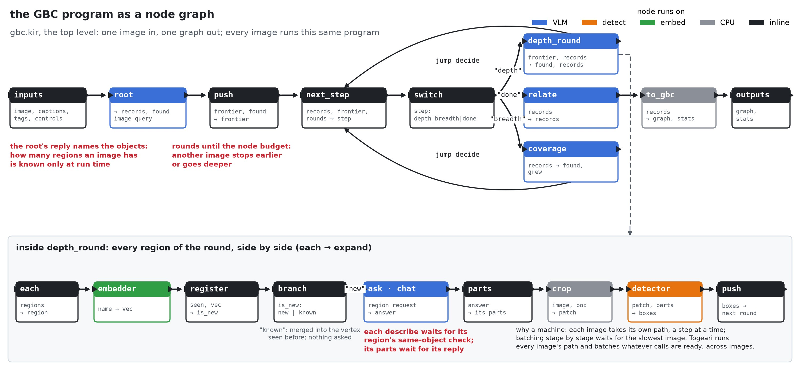
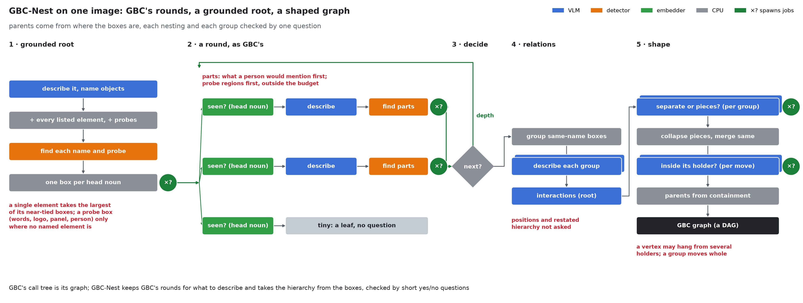

# The GBC programs

Two programs share the node library `gbc` (`kohakugbc.nodes.library.build()`), each one image
job: image, existing captions and tags, controls in; the GBC graph (JSON text) and its counts
out. Every value is passed and returned; no node mutates its inputs.

| Program | File | Entry | Graph |
|---|---|---|---|
| `gbc` | `kohakugbc/program/gbc.kir` | `gbc` | GBC's procedure: the call tree is the graph |
| `gbc_nest` | `kohakugbc/program/gbc_nest.kir` | `gbc_nest` | GBC-Nest: GBC's rounds over a grounded root, then parents from box containment, each nesting and each group checked by one question |

A machine runs one program, `machine.program` in its configuration (`gbc` by default;
`configs/programs/gbc_nest.py` is the layer for GBC-Nest). Under KIR's reference interpreter,
`kohakugbc.program.reference.run(inputs, models, program=...)`. Each program completes the job's
controls over its own defaults (`kohakugbc.program.controls.PROGRAM_DEFAULTS`).

## GBC-Nest

`gbc_nest.kir` is `gbc.kir` with four nodes swapped and one stage added:

| Step | GBC | GBC-Nest |
|---|---|---|
| root | the elements the concise caption tags | every element the image query lists (`nest_image_root`); a bracket that only modifies the next ("[anime-style] [girl]") is not one; the `probes` phrases (words, logo, comic panel, person) beside them (`with_probes`) |
| detection | per name: score, NMS, a box holding another dropped | `nest_detected`: single names sharing a head noun get one box each, one to one; a single name takes the largest of its boxes within `single_tie` of its best; containers kept; a probe box kept from `probe_score`, only where no named element's box overlaps it by `probe_gap` (IoU); a region under `small_area` of the image a leaf captioned by its name; a probe region free (described first, outside the node budget) |
| joins | an overlapping vertex whose name is the same object (embedding) | `nest_register`: never an ancestor; the best-overlapping vertex sharing the head noun (`head_overlap` both ways), else GBC's rule |
| entity query | features as an inventory | the `json_nest` prompt set: what a person would mention first (held, carried, attached, text, unusual), at most four |
| relations | on every vertex with several children, a drawn count of them | on the image vertex only (`relation_vertices = "root"`), interactions and physical connections, none allowed |
| shape | none | `shape`: one question per composition (`group_check`: separate things, or pieces of one area; pieces collapse into one region), identity merges by head noun and overlap, one question per proposed nesting (`nest_check`: the holder's box red, the child's blue), parents from containment where the answer is not no; a vertex may have several holders |
| tags (optional) | `tagging`: none, the image's, or each top-level vertex's crop | also `tag_select = "important"` (`configs/controls/tags_important.py`, a tag engine): every vertex pooled in the whole picture's pass; a vertex owns a tag where its pooled score leads every region elsewhere by `tag_local_margin`, a larger vertex at the same place holding it as strongly takes it, and a word of the tag is in the vertex's captions or its descendants'; the vertices owning at least `tag_min_tags` (at most `tag_max_regions`, none inside another) get a crop pass of their own; the image vertex keeps the whole set (`kohakugbc.nodes.tags.held`) |

The checks are model calls like any other (`ask`), so a machine batches them with the rest of
the VLM's work.

## Structure

| `@def` | Does |
|---|---|
| `ask` | a VLM request; a failed request answers with an empty reply, as GBC reads one |
| `detect` | the regions detection finds for named entities in a parent's box, one level down |
| `root` | the image vertex: GBC's image query, or existing captions (text, image and text, tags) |
| `expand` | one region: it joins a vertex seen before (`register`), or it is described and its parts detected |
| `prefill` | several regions in one request (`entity_batch` above 1) |
| `wave`, `depth_round` | one round: the frontier as it was when the round began, in waves that take what the node budget still needs |
| `coverage` | one more root sentence naming objects not covered yet |
| `relate` | relation and composition questions over the graph so far |
| `gbc` | the job: root, rounds until `next_step` says done, the relational questions, the graph; with `tagging`, the tags placed on it (`kohakugbc.nodes.tags`) |

Model nodes are transport only: `chat` (request in, reply text out), `detector` (patch and
request in, raw boxes out), `embedder` (name in, vector out), `tagger` (picture, crops and boxes
in, tag probabilities out). Request builders
(`kohakugbc.nodes.specs.chat`, `detect`) and reply parsers (`parse`) are plain nodes, so the same
requests and parsing run on any engine.

## Reproduction of the PoC

The nodes port the PoC's round engine (`gbcpoc.engine.runner`), its JSON reply layer and seeded
root, and ml-gbc's parsers, detection post-processing, same-object merge and relational
queries. Six PoC arms recorded as traces (`scripts/trace/poc_arms.py`: text, image and text, tags
and image-query roots; entity batch 4; leaf captions from the parent; 30 images each) replay
through the program under KIR's reference interpreter (`scripts/trace/replay_program.py`).

Where the program differs from the PoC, and why:

| Difference | PoC | Program |
|---|---|---|
| prompt text | prompt files read in the platform's locale encoding (cp950 on the recording machine): non-ASCII characters of the image-query system prompt garbled | prompt files read as UTF-8 |
| unseeded choices | relation count, phrase naming a set of children, composition root and wording drawn from unseeded generators | drawn from generators seeded by what is asked (`draw.rng`); the recorded runs use the same draws |
| relation sentences | repeats dropped through a `set`, order set by the process's hash seed | repeats dropped in first-seen order; the recorded runs use the same rule |
| `relational = "relation"` / `"composition"` | each keeps the other kind of question | each keeps its own kind |
| embeddings | names embedded when a same-object comparison needs them | the same: `embed_needs` names the embeddings `register` reads (overlapping vertices' names of a different singular form, up to the first equal one), each name embedded once per job; the same decisions |
| relational questions | asked after every round, answers cached by input | asked once at the end by default (`relate = "end"`); the final graph asks the same questions; `"every_round"` gives a graph after each round |
| region registration | after its query, under a per-image lock | before its query, in program order; the same order as the PoC's one-region-at-a-time rounds |

With these, every replayed job's graph equals the PoC's by digest, and every request the
program makes is one the PoC made: `tests/program` checks this on jobs cut from each arm
(`tests/fixtures/traces`), and that a broken frontier order changes graphs.
